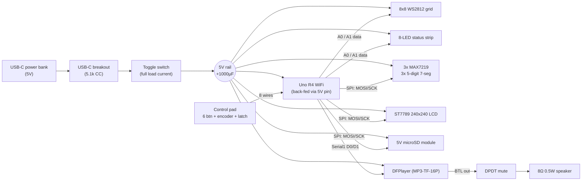

> **Scope:** Snapshot audit of the scoreboard electronics as they exist on `dev` (2026-10-16): what each subsystem is, how it is wired and powered, and the risks a PCB design has to fix. Input for `MODULAR_PCB_PROPOSAL.md`.
> **Status:** **SNAPSHOT** - Reflects `dev` @ `7213802`. Not a source of truth for wiring; `SCHEMATIC_AND_HARDWARE_GUIDE.md` remains the live wiring spec until the PCBs replace hand wiring.

# Electronics: Current State Audit

**Sources read:** `SCHEMATIC_AND_HARDWARE_GUIDE.md`, `HARDWARE_UPGRADE_MIGRATION_PLAN.md`, `SOUND_EFFECTS.md`, `COMPONENT_LIBRARIES.md`, `hardware-migration/STEP_3_IMPLEMENTATION_PLAN.md`, `wiring.png`, `src/farkle/platformio.ini`, component pin `#define`s.

---

## 1. System at a Glance

Everything is hand-wired to one **Arduino Uno R4 WiFi** (Renesas RA4M1, **5V logic**, onboard ESP32-S3 WiFi module). A single 5V USB-C source feeds every load through one toggle switch and a common ground bus.



---

## 2. Subsystem Breakdown

### 2.1 Compute
| Item | Detail |
|:--|:--|
| Board | Arduino Uno R4 WiFi (RA4M1 @ 5V I/O; ESP32-S3-MINI-1 radio module onboard) |
| Firmware target | PlatformIO `env:uno_r4_wifi` (`renesas-ra`) |
| Radio use | Optional "upload game stats" in post-game (not yet implemented) |
| Certification | The Uno R4 WiFi carries Arduino's own FCC/CE declarations, and its ESP32-S3 module holds modular radio approvals. This is the only radio in the system. |

### 2.2 Screen / Display Subsystem
| Display | Part | Interface | Pins | Notes |
|:--|:--|:--|:--|:--|
| Text/UI screen | ST7789 240x240 IPS module | HW SPI (shared) | A4 CS, A5 DC, D7 RES, D8 BLK | Module has **no CS pin**, per `STEP_3_IMPLEMENTATION_PLAN.md` §3.2 |
| Score displays | 3x MAX7219, daisy-chained, 3x 5-digit 7-seg (15 digits) | HW SPI (shared) | D10 LOAD/CS | `NUM_DEVICES 3` in `ScoreDisplay.h` |
| Progress grid | 8x8 WS2812 ("NeoPixel") panel | 1-wire | A0 | 64 px |
| Status strip | 8x WS2812 | 1-wire | A1 | Farkle "danger map" |

### 2.3 Gamepad / Control Pad
| Input | Pins | Encoding |
|:--|:--|:--|
| 6 game buttons (BANK, FARKLE, CLEAR, +50, +100, +500) | D5 (bit 2), D6 (bit 1), A2 (bit 0) | 3-bit binary bus, `INPUT_PULLUP`, active-low |
| Rotary encoder A/B | D2/D3 | Interrupts |
| Encoder push (SELECT) | D4 | Independent digital |
| Latching "Total Score" switch | A3 | Static level |

Total: **8 signal wires + GND** from the pad to the MCU.

### 2.4 Audio
DFPlayer Mini clone (MP3-TF-16P) on `Serial1` (D0/D1, 1 kΩ inline on the MCU TX line). Onboard 3W BTL amp drives a 0.5W 8Ω speaker through a DPDT mute switch. It has its own microSD for audio files.

### 2.5 Storage
"5V-native" microSD breakout (LVC125A-style buffer + 3.3V regulator) on shared SPI: D9 CS, D12 MISO. Holds `/sys/`, `/partial/`, `/archive/` game data and journal (see `MEMORY_FILE_TREE.md`).

### 2.6 Power
| Item | Current state |
|:--|:--|
| Source | USB-C power bank (10,000 mAh, ≥2.4A port recommended) via a USB-C breakout with 5.1 kΩ CC pull-downs |
| Switching | Toggle switch in series with the **full** 5V load current |
| MCU feed | 5V rail back-fed into the Uno R4 5V pin |
| Filtering | 1000µF bulk at input; 0.1µF at LCD, MCU, and A2 (Issue #80) |
| Protection | None (no fuse, TVS, current limit, or inrush control) |
| Budget in guide | ~1.83A typical, rounded to 2.0A |

---

## 3. Pin Budget

Every Uno header pin is used. **D12 (MISO)** is shared with SD, and the **Qwiic connector** (I2C, 3.3V) is the only untouched interface.

| D0 | D1 | D2 | D3 | D4 | D5 | D6 | D7 | D8 | D9 | D10 | D11 | D12 | D13 | A0 | A1 | A2 | A3 | A4 | A5 |
|:--|:--|:--|:--|:--|:--|:--|:--|:--|:--|:--|:--|:--|:--|:--|:--|:--|:--|:--|:--|
| MP3 RX | MP3 TX | ENC A | ENC B | SELECT | BUS2 | BUS1 | LCD RES | LCD BLK | SD CS | SEG CS | MOSI | MISO | SCK | GRID | STRIP | BUS0 | LATCH | LCD CS | LCD DC |

**Implication:** any new hardware feature (e.g. power-source sensing, a battery gauge, button LEDs) needs either a port expander or a different compute part.

---

## 4. Revised Power Budget

The guide's 2.0A figure covers **typical** play. A PCB and its power path must also survive the **worst case**, such as a firmware bug or a test pattern that turns every LED white.

| Load | Typical | Worst case | Basis |
|:--|:--|:--|:--|
| 8x8 grid (64 px) | ~1.3 A | **3.84 A** | 60 mA/px full white; firmware uses full-saturation hues (~20–40 mA/px) |
| Status strip (8 px) | ~0.1 A | 0.48 A | 60 mA/px |
| 3x MAX7219 | ~0.3 A | ~1.0 A | All segments, max intensity; set by R_SET |
| LCD + backlight | ~0.05 A | 0.08 A | Module typical |
| DFPlayer + amp | ~0.1 A | 0.2 A | `SOUND_EFFECTS.md` |
| Uno R4 WiFi | ~0.1 A | 0.25 A | WiFi TX bursts |
| **Total** | **~2.0 A** | **~5.8 A** | |

A USB-C source supplies at most **3.0A at 5V** without USB-PD negotiation. Worst case is about 2x what any USB-C source can deliver. Two things can follow: the power bank trips (the scoreboard powers off mid-game), or the rail sags enough to brown out the MCU **during an SD journal write**.

---

## 5. Findings

Severity: **H** = likely root cause of observed problems or a data/hardware-damage risk. **M** = must fix on a PCB. **L** = nice to fix.

| # | Sev | Subsystem | Finding | Why it matters |
|:--|:--|:--|:--|:--|
| F1 | **H** | Screen | **The ST7789 has no CS but shares SPI with the MAX7219s and SD.** With CS absent (or tied low), the LCD clocks in *every* SPI transfer meant for the score displays and SD card. Depending on the DC level at that moment, it treats the bytes as pixel data or as **commands**. | Random LCD corruption. This may be part of what Issue #80 attributed to "dirty power". A CS-capable LCD module, or a clock gate on the PCB, removes the failure mode entirely. |
| F2 | **H** | Power | Worst-case load (~5.8A) exceeds what the USB-C source can supply (3A), and nothing limits current. | Power-bank trip or brown-out mid-write leaves the SD journal corrupted. Firmware needs a global LED current cap and hardware needs a current-limited input. |
| F3 | **M** | Power / noise | All LED return current flows through the same ground wiring as the logic and inputs (common bus, no partitioning). | This is the most likely physical source of the noise seen on A2 and the LCD. A PCB with a solid ground plane and a separate LED current path fixes it at the root. Capacitors only treat the symptom. |
| F4 | **M** | Gamepad | **The docs don't say how multi-bit buttons are isolated.** +500 (011), +100 (110), and +50 (111) must each pull 2–3 bus lines low. Unless that is done with **steering diodes** (or multi-pole switches), the lines are tied together permanently and single-bit buttons read wrong. | Needs confirming against the physical build. On a PCB this costs 10 small Schottky diodes. |
| F5 | **M** | Gamepad | **Chord aliasing:** two buttons pressed together OR their codes. FARKLE+CLEAR reads as **+500** and BANK+FARKLE reads as **+100**. Ghost UNDO (BANK+CLEAR = 101) relies on this same mechanism. | An accidental two-finger press scores points. The 50ms stability window reduces the chance but cannot remove it. The encoding scheme itself has to change to fix this (see proposal §4.4). |
| F6 | **M** | Screen | ST7789 modules without a level shifter are 3.3V parts but are driven with **5V SPI logic** from the RA4M1. | Works on the bench but is outside the controller's I/O rating, so it's a long-term reliability risk. |
| F7 | **M** | Power | A 1000µF capacitor hot-plugged straight onto USB VBUS with no soft-start. | USB sources limit inrush. Some power banks will latch off or fail to start, and the toggle switch contacts arc. |
| F8 | **M** | Compute | The R4 is back-fed through its 5V pin while USB may also be connected for programming. | Confirm on the Uno R4 WiFi schematic that USB VBUS and the 5V pin are isolated. Otherwise the PC port and the power bank fight each other. |
| F9 | **L** | Power | The toggle switch carries 2–6A of load current. | Needs a properly rated switch. On a PCB it should switch an eFuse *enable* pin (µA) instead. |
| F10 | **L** | LEDs | No series resistor on the WS2812 data lines, and no buffering for long runs. | Ringing and first-pixel damage on hot-plug. Fix with a 330Ω series resistor at the source. |
| F11 | **L** | Audio | DFPlayer clones are noise-sensitive (hum/pops from a shared 5V rail with LED PWM). | Give the DFPlayer a ferrite-filtered supply branch on the PCB. |

---

## 6. Documentation Drift (worth fixing independently)

1. **`wiring.png` is the V1 design.** It shows an I2C LCD, an analog ladder on A1/A2, the speaker on D9, and "2x MAX7219". All of these have been superseded by `SCHEMATIC_AND_HARDWARE_GUIDE.md`.
2. **Display count disagrees:** "2x MAX7219" in `wiring.png` vs 3 in code (`NUM_DEVICES 3`).
3. **The Mermaid diagram in `SCHEMATIC_AND_HARDWARE_GUIDE.md` isn't in a ` ```mermaid ` fence** (and its brackets are escaped), so GitHub renders it as plain text.
4. **The D12 MISO** connection to the SD card is missing from the guide's Mermaid diagram and pin map.
5. **`AGENTS.md` build command** says `pio run -e esp32dev`, but `platformio.ini` only defines `uno_r4_wifi`.
6. **The power budget** leaves out the status strip and doesn't distinguish typical from worst case (see §4).
