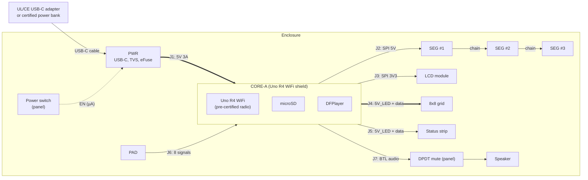
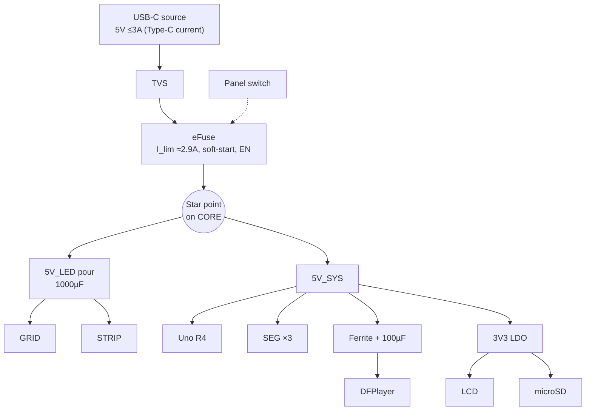

> **Scope:** Proposed set of custom PCBs, the off-the-shelf modules they host, the board-to-board interconnect, the power architecture, the certification strategy (certified PSU + pre-certified radio), and the enclosure interface for the Farkle Scoreboard.
> **Status:** **PROPOSAL** - Not yet agreed. Open questions in §11 must be answered by Guillermo before schematic capture starts. Builds on findings F1–F11 in `ELECTRONICS_CURRENT_STATE.md`.

# Modular PCB Architecture Proposal

## 0. TL;DR

*   **Six custom boards from four unique designs:** `PWR` (USB-C power entry), `CORE` (compute carrier), `SEG` ×3 (identical score-display boards), and `PAD` (gamepad).
*   **Buy, don't build:** the 8x8 LED grid, the 8-LED strip, the ST7789 LCD (a CS-capable module), the DFPlayer, and the compute module.
*   **Phase A** keeps the Uno R4 WiFi and **today's pin map**, so firmware is unchanged. `CORE-A` is a shield the R4 plugs into.
*   **Phase B** (optional) replaces it with `CORE-B`, which puts a pre-certified ESP32-S3 module directly on the board. Because the connectors are fixed, **every other board carries over unchanged**.
*   **Certification boundary:** no mains, no battery, and no radio design inside the product. Power comes from a UL/CE-listed USB-C adapter (or a certified power bank). The only radio is a module with existing modular approvals.

---

## 1. Design Principles

1.  **Stay inside the certified boundary.** Anything that is expensive to certify (AC/DC conversion, lithium cells, RF front-ends) is bought as a finished, certified product and never designed by us. See §7.
2.  **Firmware pin map is frozen in Phase A.** Every custom board is designed so the existing `ControlPad`, `ScoreDisplay`, `TextDisplayV2`, `MemoryCard`, `SoundPlayer`, `LedProgressGrid`, and `FarkleWarningLights` code runs unmodified.
3.  **Connectors are the contract.** Each board-to-board connector has one pinout, defined in §5, and it never changes between phases. That is what makes the system modular.
4.  **Repeat, don't vary.** The three score displays are one PCB design built three times and daisy-chained.
5.  **Separate the high-current LED path from logic** on every board: dedicated pours and a star point at the power input (fixes F3).
6.  **Hand-solderable or JLCPCB-assemblable.** 2-layer where possible, 0603/0805 passives, SOIC/SOT packages, no BGAs.

---

## 2. Board Set

| ID | Board | Type | Contents | Layers | Est. size | Qty/unit |
|:--|:--|:--|:--|:--|:--|:--|
| **PWR** | Power entry | Custom | USB-C sink, TVS, eFuse (current limit + soft-start), power-switch input, power-good LED | 2 | ~35×25 mm | 1 |
| **CORE-A** | Compute carrier (Phase A) | Custom | Uno R4 WiFi shield: rail distribution, 3V3 LDO, level translation, LCD clock gate, microSD socket, DFPlayer socket, LED data buffers, all peripheral connectors | 2 (4 optional) | Uno footprint, ~70×55 mm | 1 |
| **SEG** | Score display | Custom | MAX7221 (or MAX7219) + 5× 7-segment digits, R_SET, decoupling, IN/OUT chain connectors | 2 | ~105×35 mm for 0.56" digits | **3** |
| **PAD** | Gamepad / control pad | Custom | 6 buttons, EC11 encoder + push, latching switch, steering diodes, ESD | 2 | Set by button layout | 1 |
| GRID | 8x8 LED panel | **Buy** | WS2812B 8x8 panel (rigid PCB type) | – | 65×65 mm typ. | 1 |
| STRIP | Status strip | **Buy** | 8× WS2812B stick | – | – | 1 |
| LCD | 240x240 IPS | **Buy** | ST7789 module **with a CS pin** (fixes F1) | – | – | 1 |
| AUD | MP3 player | **Buy** | DFPlayer Mini, socketed on CORE | – | – | 1 |
| *CORE-B* | *Compute (Phase B)* | *Custom* | *ESP32-S3-WROOM-1 module-down, same connectors as CORE-A* | *4* | *~70×55 mm* | *1* |

**Why not one board?** See §10. In short: the front-panel layout isn't frozen yet. Separate boards let the enclosure move a display without re-spinning everything, and the LED current stays physically away from the logic.

---

## 3. System Topology

`==>` marks a high-current path.

---

## 4. Board Details

### 4.1 PWR: Power Entry
*   **Connector:** USB-C receptacle, power-only (6-pin power-only types are fine in Phase A). **5.1 kΩ Rd on CC1 and CC2, each separate** (never shared).
*   **Protection:** unidirectional 5V TVS on VBUS (e.g. SMBJ5.0A class) right at the connector.
*   **eFuse:** an integrated eFuse (candidate: TI TPS2595 / TPS25947 family) set to **~2.9 A**. It provides:
    *   Current limit (F2): a firmware bug can't trip the power bank or brown out the MCU.
    *   Soft-start (F7): the downstream bulk capacitance no longer slams the source.
    *   **EN pin driven by the panel power switch** (F9): the switch only carries µA, so a small illuminated or latching switch works.
    *   Keeping input power ≤15 W helps the product stay in the lowest power-source class under IEC 62368-1 (§7.3).
*   **Bulk:** 100–220 µF after the eFuse. The large reservoir moves to CORE next to the LED connectors.
*   **Output:** J1 (§5). Power-good LED.
*   **Why a separate board:** the USB-C port has to sit at an enclosure wall the enclosure chooses. This keeps the ESD and hot-plug event at that wall, it's tiny and cheap, and it's the board most likely to change if the power source changes.

### 4.2 CORE-A: Compute Carrier (Uno R4 WiFi shield)
The R4 plugs into CORE-A through standard Uno headers. CORE-A does all the electrical cleanup, and **pin assignments are identical to `SCHEMATIC_AND_HARDWARE_GUIDE.md`**.

| Block | Implementation | Fixes |
|:--|:--|:--|
| **Power distribution** | J1 in → star point → (a) **5V_LED** pour to J4/J5 with **1000µF + 100nF** at the connectors; (b) **5V_SYS** to the R4 5V pin, SEG, and DFPlayer. The DFPlayer gets its own **ferrite + 100µF** branch. | F3, F11 |
| **3V3 rail** | Own LDO (e.g. AP2112K-3.3, 600mA) from 5V_SYS for LCD + microSD. Doesn't rely on the R4's 3V3 pin budget. | F6 |
| **LCD level shift + CS** | 74LVC245A powered at 3.3V (5V-tolerant inputs) translates SCK, MOSI, CS (A4), DC (A5), RES (D7), BLK (D8) down to 3.3V. With a **CS-capable LCD**, A4 drives CS directly. If the chosen LCD has *no* CS, a 74LVC1G125 gates the LCD's SCK using A4 as enable (DNP option), so it only sees its own traffic. | F1, F6 |
| **microSD** | Socket on CORE at a board edge (aligned to an enclosure slot if users swap cards). Down-shift via 74LVC125A @3.3V. **MISO up-shift + tri-state** via 74AHCT1G125 @5V, enabled by SD CS (D9), which also stops the card holding MISO when deselected. Replaces the 5V SD breakout. | Robust shared bus |
| **SEG bus buffer** | 74AHCT125 @5V buffers MOSI/SCK/CS(D10) toward J2, with 33Ω series resistors to drive a short cable. TTL thresholds mean it accepts 3.3V input in Phase B unchanged. | Phase-B ready |
| **LED data** | Remaining 74AHCT125 channels buffer A0 → J4 and A1 → J5, with 330Ω series at the connector. | F10 |
| **Gamepad input** | J6 lines get 10 kΩ external pull-ups to 5V, 1 kΩ series + 10nF RC, and two 4-channel TVS arrays at the connector (e.g. TPD4E05U06). | Noise, ESD |
| **Audio** | DFPlayer in a socket; 1 kΩ on TX→RX kept from today's design; BTL outputs to J7. | – |
| **Back-feed guard** | Verify the R4 WiFi USB/5V-pin power path from the Arduino schematic (F8). If it isn't isolated, add an ideal-diode (or Schottky) stage so the PC USB port and PWR can't back-feed each other while programming. | F8 |

### 4.3 SEG: Score Display (×3, identical)
*   **Driver:** prefer **MAX7221** over MAX7219. It's register-compatible (`ScoreDisplay` doesn't change). It has a **true SPI CS**, so it ignores LCD/SD traffic, and **slew-limited segment drivers**, which make EMC easier (§7.4). Note: many cheap MAX7219 boards use clone chips, so buy from an authorized distributor.
*   **Digits:** 5× common-cathode 7-segment digits (0.56" or 0.8" per the enclosure). R_SET chosen for the brightness wanted at intensity 12/15, not maximum, which keeps current near the typical budget.
*   **Decoupling:** 10µF electrolytic/ceramic + 100nF at V+ per chip, per the MAX7219/7221 datasheet layout guidance.
*   **Chain:** `SEG_IN` (from CORE or the previous SEG) and `SEG_OUT` (DOUT → next DIN, plus CLK/CS/5V/GND pass-through) use the **same pinout**, so the boards chain in any order. Device index = position in the chain (matches `addDisplay(type, deviceIndex)`).

### 4.4 PAD: Gamepad / Control Pad
*   **Phase A (no firmware change):** keep the 3-bit bus, done properly on the PCB:
    *   **Steering diodes** (Schottky, e.g. BAT54 series; low Vf keeps a "pressed" line well below the MCU's V_IL) from each bus line to each button. Required diodes per button: CLEAR 1, FARKLE 1, BANK 1, +500 2, +100 2, +50 3, so **10 total**. (F4)
    *   EC11 encoder with the 10 kΩ/10nF RC filtering recommended in encoder application notes; SELECT and LATCH direct.
    *   Mounting holes for panel mount *or* a handheld shell (open question Q3).
*   **Chord aliasing (F5) can't be fixed by layout.** Options, decided with Guillermo:
    1.  **Accept it.** Rely on the 50 ms stability window and button spacing, and document the alias table.
    2.  **Re-assign codes** so the likely accidental chords (adjacent buttons) OR into **NONE-like or harmless** codes. This is a firmware + PAD change but no new parts.
    3.  **Phase B: put an I/O expander on the PAD** (e.g. TCA9555 / MCP23017 on I2C, interrupt line to MCU). Each button gets its own bit, chords are unambiguous, and **five MCU pins are freed**. ControlPad then reads the expander instead of three pins.

### 4.5 Bought Modules: Selection Rules
| Module | Must have | Avoid |
|:--|:--|:--|
| LCD | ST7789 240x240 **with CS pin broken out**, mounting holes | 1.3" no-CS variants (F1) |
| Grid | WS2812B (or SK6812) 8x8 on rigid PCB, separate 5V/GND/DIN pads, mounting holes | Flexible panels (hard to diffuse/mount) |
| Strip | 8× WS2812B stick with through-holes | – |
| DFPlayer | Genuine DFRobot DFR0299 preferred | Unbranded clones if audio noise is a problem (F11) |

---

## 5. Interconnect Specification

Signal connectors are **JST-PH (2.0 mm, keyed, locking)**. High-current connectors are **JST-VH (3.96 mm)**. Pin 1 is marked on silkscreen and in this table. GND is interleaved on SPI cables.

| Conn | From → To | Type | Pinout | Max I |
|:--|:--|:--|:--|:--|
| **J1** | PWR → CORE | VH-4 | 1 5V, 2 5V, 3 GND, 4 GND | 3 A |
| **J2** | CORE → SEG_IN; SEG_OUT → next SEG_IN | PH-6 | 1 5V, 2 GND, 3 DIN, 4 GND, 5 CLK, 6 CS | 1 A |
| **J3** | CORE → LCD | PH-8 | 1 3V3, 2 GND, 3 SCK, 4 MOSI, 5 RES, 6 DC, 7 CS, 8 BLK | 0.1 A |
| **J4** | CORE → GRID | VH-3 | 1 5V_LED, 2 DATA, 3 GND | 3 A (fused by PWR) |
| **J5** | CORE → STRIP | PH-3 | 1 5V_LED, 2 DATA, 3 GND | 0.5 A |
| **J6** | PAD → CORE | PH-10 | 1 GND, 2 BUS0, 3 BUS1, 4 BUS2, 5 SELECT, 6 ENC_A, 7 ENC_B, 8 LATCH, 9 GND, 10 **VPAD (reserved)** | – |
| **J7** | CORE → mute switch → speaker | PH-2 | 1 SPK_1, 2 SPK_2 | 0.3 A |
| **J8** | PWR ← power switch | PH-2 | 1 EN, 2 GND | µA |

*   **J6 pin 10 (VPAD)** is reserved so the Phase B I/O-expander PAD (or lit buttons) can draw power without a new connector. In Phase B, CORE-B reuses BUS0/BUS1 as SDA/SCL and BUS2 as INT. CORE-B leaves the J6 RC capacitors unpopulated (they would slow I2C edges) and pulls up to 3V3.
*   **Cable lengths:** keep J2/J3 (SPI) under ~30 cm. The MAX7221 is limited to 10 MHz, so firmware must use a separate `SPISettings` per device (the LCD can run faster).

---

## 6. Power Architecture

**Budget rules, enforced in firmware:** the hardware limit is 2.9 A and the firmware design budget is **≤ 2.4 A**.
*   Cap the grid plus strip at an aggregate LED current using a global brightness ceiling (e.g. `setBrightness`) **derived from a documented per-pixel estimate**. This needs a firmware design note in `COMPONENT_LIBRARIES.md` (LedProgressGrid / FarkleWarningLights).
*   Keep MAX7221 intensity at ≤12/15 (already the blink-high level).
*   Optional (Phase B, needs a pin or ADC): PWR exposes CC voltage so firmware can tell a 1.5 A source from a 3 A source and dim accordingly.

---

## 7. Certification Strategy

> Assumption: "UE certified" in the brief means **UL (North-America safety) + CE (EU)**, with FCC as the US radio/EMC equivalent. Confirm (Q1).

### 7.1 If the scoreboard is never sold
47 CFR §15.23 allows home-built devices in small quantities (not marketed) without FCC authorization, provided they don't cause interference. None of §7.2–7.4 is required, though the design still follows it so a later sale stays possible.

### 7.2 Power: use a certified PSU, design none
*   Ship with (or specify) a **USB-C wall adapter** that carries **UL/ETL listing to UL 62368-1, CE + UKCA marks, and DoE Level VI** efficiency. 5V/3A (15 W) or more. Any USB-PD adapter supplies 5V/3A without negotiation.
*   Power banks: only branded units with their own UL 2056 / IEC 62133 certification.
*   **No internal battery.** A lithium cell inside the product would bring UN38.3 (shipping), IEC 62133-2, and charger design into scope.
*   With only 5V DC inside, the product sits below the Low Voltage Directive range (75 V DC). Electrical-safety risk lives in the adapter, which is already certified.

### 7.3 Product safety (still ours)
*   IEC/UL 62368-1 still applies to the finished product (under CE it comes via RED Art. 3.1(a) if a radio is present). Limiting input to **≤15 W** with the eFuse keeps the boards in the lowest power-source class, which relaxes enclosure fire-rating requirements. Confirm with the test lab.
*   Use **UL 94 V-0 or V-1** enclosure material if possible (PETG/ABS FR grades; standard PLA is not rated).

### 7.4 Wireless: pre-certified module only
*   **Phase A:** the Uno R4 WiFi's onboard ESP32-S3-MINI-1 module is the only radio. Don't modify the R4, and keep its antenna end clear (§8).
*   **Phase B:** use **ESP32-S3-WROOM-1** (PCB antenna) placed directly on CORE-B. To reuse Espressif's modular grant:
    *   Follow Espressif's hardware design guidelines for **antenna keep-out**: no copper on any layer under or around the antenna, and the antenna at the board edge.
    *   Use only the antenna the module was certified with (avoid `-1U` external-antenna variants unless using a listed antenna).
    *   Label the product **"Contains FCC ID: …"** with the module's grant ID, and the IC equivalent.
*   **What the module does *not* cover:** the *whole product* still needs:
    *   **US:** FCC Part 15 **Subpart B** (unintentional radiator) via Supplier's Declaration of Conformity. This is a pre-scan/test of the digital emissions from MAX72xx multiplexing, WS2812 data, and SPI.
    *   **EU:** the **Radio Equipment Directive** (because a radio is present, even if WiFi is unused). That means EMC (EN 301 489-1/-17), radio (EN 300 328, usually satisfied by the module's reports), safety (EN 62368-1), RF exposure (EN 62479), plus RoHS and WEEE.
    *   **Design lever:** if WiFi stats upload isn't a real requirement (Q5), a **non-radio MCU in Phase B** drops RED and leaves the simpler EMC Directive.
*   **EMC design practices baked into this proposal:** a solid ground plane on every board, MAX7221 slew-limited drivers, series resistors on all off-board clocks and data, TVS at every user-touchable connector, LED current kept off the logic ground, and short SPI cables.

---

## 8. Enclosure Interface

| Area | Requirement |
|:--|:--|
| **Front panel** | SEG ×3, GRID, LCD, STRIP (and PAD if integrated) mount **to the front panel** on M3 standoffs. Boards define their own hole patterns. Keep all board outlines on a 2.5 mm grid with M3 holes ≥3 mm from the edge. |
| **Rear / base** | CORE and PWR mount to the base. PWR sits **against a wall** so the USB-C receptacle is flush with a panel cut-out (no USB pigtails). |
| **Panel controls** | Power switch (J8), mute DPDT (J7), latching "Total" switch (on PAD). |
| **Service access** | Game-data microSD slot reachable through an enclosure slot *or* behind a screw panel (Q6). DFPlayer audio card is internal. USB for firmware updates reachable (Phase A: the R4's USB-C, Phase B: CORE-B native USB). |
| **Antenna keep-out** | Radio module antenna ≥15 mm from metal, screws, the LED grid, and the speaker magnet, facing an enclosure wall. **No metal enclosure.** |
| **Optics** | Grid: printed baffle (one cell per pixel) + diffuser. 7-seg: smoked/red acrylic filter. LCD: window with bezel overlap. |
| **Thermal** | Worst case ~15 W in, mostly as LED heat on the front panel. Passive is fine, and small vents above the grid are recommended. |
| **Acoustic** | Speaker grille + sealed back volume for the 36 mm driver. |
| **ESD** | Plastic enclosure; buttons with plastic caps; TVS on PAD lines (CORE §4.2). |

---

## 9. Phasing

| Phase | Deliverable | Firmware impact | Gate to next phase |
|:--|:--|:--|:--|
| **A1** | PWR + CORE-A schematics and layout; order with the bought modules | None | Board bring-up: all existing tests pass and all subsystems are verified on hardware |
| **A2** | SEG + PAD | None (MAX7221 is drop-in) | Full game played on PCBs only, no hand wiring |
| **A3** | Enclosure v1 around the A-boards | LED current-cap design note | Thermal and brightness OK; no LCD corruption over a full game |
| **B** *(optional)* | CORE-B (ESP32-S3-WROOM-1) and/or PAD with I/O expander | Port to `esp32` platform; ControlPad reads expander | Decide based on Q2, Q5, and pin needs |
| **C** *(volume only)* | Merge SEG ×3 + GRID + STRIP into one front-panel board | None | Front layout frozen |

---

## 10. Alternative Considered: Single Board

One large front-panel PCB with all displays, LEDs, buttons, and the compute on the back.

| | Single board | Modular (proposed) |
|:--|:--|:--|
| Harness | None | 8 short keyed cables |
| Unit cost at volume | Lower | Slightly higher (connectors) |
| Prototype cost per re-spin | High (large board) | Low (only the changed board) |
| Enclosure freedom | Locked to PCB | Displays placed independently |
| Noise isolation | Needs careful partitioning | Physical separation by default |
| Compute upgrade | Full re-spin | Swap CORE only |

**Recommendation:** modular now, while the layout and compute choice are still moving. Phase C consolidates once they are frozen.

---

## 11. Open Questions (for Guillermo)

1.  **Q1, Goal:** personal build, a handful of gifts, or sale? And does "UE" mean UL + CE? This decides how much of §7 is mandatory.
2.  **Q2, Compute:** happy to keep the Uno R4 WiFi long-term (Phase A only), or interested in Phase B?
3.  **Q3, Gamepad form:** are the controls part of the scoreboard front panel, or a **tethered handheld pad** on a cable? (This changes J6's connector to a panel-mount locking type and adds cable ESD considerations.)
4.  **Q4, Current wiring:** how are the multi-bit buttons isolated today, with diodes or multi-pole switches (F4)? And does the current LCD module really have no CS pin (F1)?
5.  **Q5, WiFi:** is stats upload a real requirement? If not, it changes the Phase B radio and certification picture (§7.4).
6.  **Q6, SD access:** do players ever remove the game-data card, or is it internal-only?
7.  **Q7, Sizes:** target enclosure dimensions, 7-segment digit height, and button type (arcade 24/30 mm vs tactile)?
8.  **Q8, Fab:** hand-solder, or JLCPCB/PCBWay assembly? This decides package choices.
9.  **Q9, Chord aliasing:** which option in §4.4 (accept / re-assign / expander)?

---

## 12. Proposed Repo Additions (once agreed)

*   `hardware/kicad/<board>/`: one KiCad project per board (PWR, CORE-A, SEG, PAD) with shared symbol/footprint library `hardware/kicad/lib/`.
*   `hardware/bom/`: per-board BOM with LCSC/DigiKey part numbers.
*   `hardware/enclosure/`: CAD source + STLs.
*   `design/pcb-design/`: this folder stays the live spec. `SCHEMATIC_AND_HARDWARE_GUIDE.md` becomes "harness and connector guide" once hand wiring is retired.
